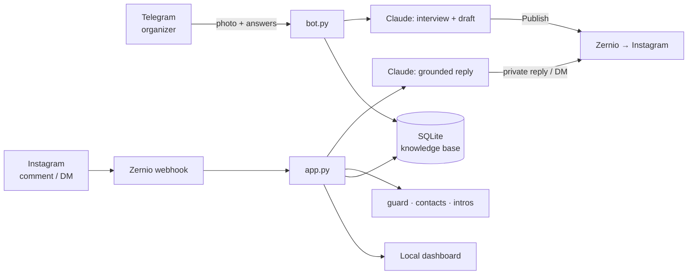

<div align="center">

# Social GTM Concierge

**An AI-powered event concierge that turns live team interviews into Instagram content and converts engagement into warm leads — built on [Zernio](https://zernio.com) + [Claude](https://www.anthropic.com).**

[](pyproject.toml)
[](https://fastapi.tiangolo.com/)
[](https://www.anthropic.com)
[](https://zernio.com)
[](tests/)

*Built for the **Social GTM Agents Hackathon** (swanbase × Zernio, Paris · 15 Nov 2026)*  
[中文说明](README_zh.md)

</div>

---

## ✨ What it does

Walk the room with a Telegram bot in your pocket: snap a team photo, relay a few answers, and let the concierge handle the rest.

- **🎙️ Interview → Post** — Adaptive, style-configurable interview in Telegram; Claude drafts a structured record + Instagram caption and publishes via Zernio.
- **💬 Engage → Convert** — Replies to Instagram comments, follows up in DMs with the most relevant projects, answers from published interview knowledge only.
- **🤝 Intro & CTAs** — Shares public team contacts verbatim from the DB or routes intro requests to the organizer; serves configurable, expiring CTAs.
- **📊 Observe** — Local-only live dashboard for teams, activity, interests, and comment→DM latency.

## 🔄 How it works



## 🛡️ Guardrails

| Area | Behavior |
|---|---|
| **Grounding** | Answers come only from published interviews and `concierge/event_info.py` (structured outputs for every Claude call). |
| **Link safety** | Non-whitelisted URLs are stripped in code before sending; each link sent at most once per person. |
| **Contacts** | Shared only when public & valid; requester contact saved only if explicitly provided. Intro flow for private teams. |
| **Loop/abuse guard** | Skips repeated/bot-marked messages, HMAC-verified & de-duped webhooks, 30 auto-replies/person/day, `/resume` handoff. |
| **Privacy** | Dashboard is localhost-only, shortens usernames, hides contact details. `data/` is git-ignored (photos/usernames/contacts). Telegram access: owner + allow-list. |

## 🧱 Project structure

```text
concierge/
  run.py          # one-command start/stop: app + tunnel + webhook
  app.py          # FastAPI: Zernio webhooks, guards, intros; starts Telegram bot
  bot.py          # Telegram interview bot and commands
  llm.py          # Claude structured calls (interview, draft, replies, recap)
  event_info.py   # event config, CTAs, interview styles (edit per event)
  guard.py        # link whitelist          contacts.py: contact extraction
  store.py        # SQLite: interviews, leads, DM history, intros, events
  dashboard.py    # local-only live dashboard (+ dashboard.html)
  media.py        # Instagram image prep and recap collage
  zernio.py       # Zernio REST client
probe/setup.py    # CLI: webhooks, accounts, webhook secret
tests/            # pytest suite (no network, no live DB writes)
```

## 🚀 Quick start (local)

### Prerequisites

- macOS or Linux
- [`uv`](https://docs.astral.sh/uv/) (installs pinned Python)
- [`cloudflared`](https://developers.cloudflare.com/cloudflare-one/connections/connect-networks/downloads/) — e.g. `brew install cloudflared`
- [Zernio](https://zernio.com) account with an Instagram **Business/Creator** account connected + Zernio API key
- [Telegram bot token](https://t.me/BotFather)
- [Anthropic API key](https://console.anthropic.com/)

### 1) Install & configure

```bash
git clone git@github.com:mehditebib00-prog/hackaton-agent-swanbase-zernio-.git
cd hackaton-agent-swanbase-zernio-
uv sync

cp .env.example .env
uv run python -m probe.setup gen-secret   # writes ZERNIO_WEBHOOK_SECRET into .env
```

Fill `.env`:

| Variable | Required | Description |
|---|:---:|---|
| `ZERNIO_API_KEY` | ✅ | Zernio API key |
| `ZERNIO_WEBHOOK_SECRET` | ✅ | Webhook signing secret (`gen-secret` creates it) |
| `TELEGRAM_BOT_TOKEN` | ✅ | Token from @BotFather |
| `ANTHROPIC_API_KEY` | ✅ | Claude API key |
| `ZERNIO_IG_ACCOUNT_ID` | — | Pin Instagram account (defaults to first connected) |
| `TELEGRAM_OWNER_ID` | — | Fix owner (otherwise first `/start` becomes owner) |

> `.env` overrides shell vars. **Never commit `.env` or print keys/tokens.**

Verify Zernio sees your Instagram account:
```bash
uv run python -m probe.setup accounts
```

### 2) Run

```bash
uv run python -m concierge.run
```

- Wait for **`READY`** — starts FastAPI on `:8000`, opens a cloudflared quick tunnel, (re)points the Zernio webhook, and sends a test event.
- **Dashboard:** http://localhost:8000/dashboard *(localhost only)*
- **Health:** `curl http://localhost:8000/health`
- **Logs:** `data/app.log`, `data/tunnel.log`
- **Stop:** `Ctrl-C` or `uv run python -m concierge.run --stop`

> Quick-tunnel URLs change on every start; the script re-registers the webhook automatically.

## 💬 Telegram commands

| Command | Who | Purpose |
|---|---|---|
| `/start` | anyone | Claim owner (first) or request access |
| `/allow <id>` | owner | Allow a teammate to interview/publish |
| *photo + caption* | members | Start a team interview |
| `/done` | members | Finish early and draft |
| `/style [preset\|text]` | members | Set style: journalist, casual, investor, storyteller, or custom |
| `/contact [id] [contact\|none]` | members | List/set/clear a team’s public contact |
| `/recap` | members | Collage + end-of-day recap post |
| `/stats`, `/export` | members | Engagement summary; CSV export (private chat) |
| `/resume <ig username>` | members | Hand a conversation back to the bot |
| `/cancel` | members | Clear current interview |

## 🎨 Customize for another event

Edit **`concierge/event_info.py`** (`EVENT`, `CTAS`, `STYLE_PRESETS`) — prompts stay event-agnostic and read facts from there. No other code changes required.

## 🧪 Development

```bash
uv run pytest -q
uvx ruff check concierge tests --select F,B
uvx pyright --pythonpath .venv/bin/python concierge
```

Tests run without network access and without touching a live database (`tests/conftest.py` stubs event logging).

## 🔐 Data & privacy

Runtime data lives in `data/` (git-ignored): SQLite DB, team photos, and logs. It may contain personal data — **do not commit or share it**. Delete `data/` to reset the event.

## 🧰 Built with

[Zernio](https://zernio.com) · [Claude Opus 5.5](https://www.anthropic.com) · [FastAPI](https://fastapi.tiangolo.com/) · [python-telegram-bot](https://python-telegram-bot.org/) · SQLite · [cloudflared](https://developers.cloudflare.com/cloudflare-one/)
